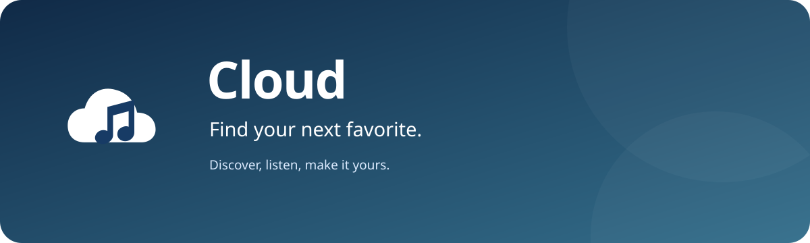
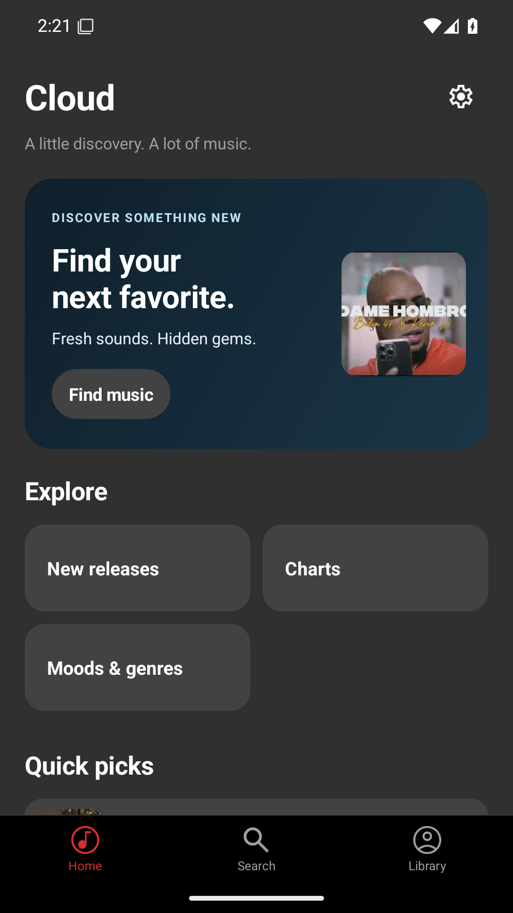
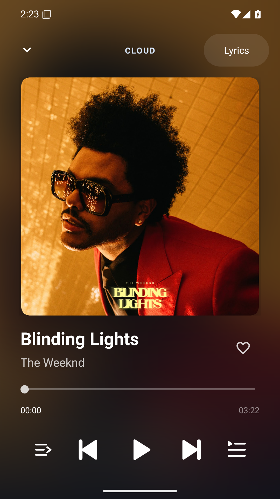
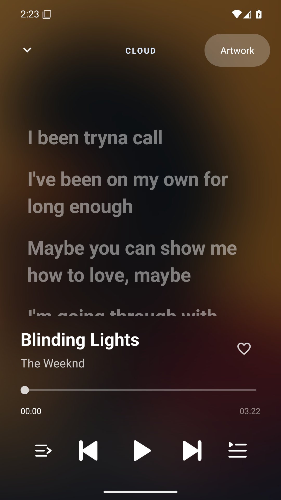
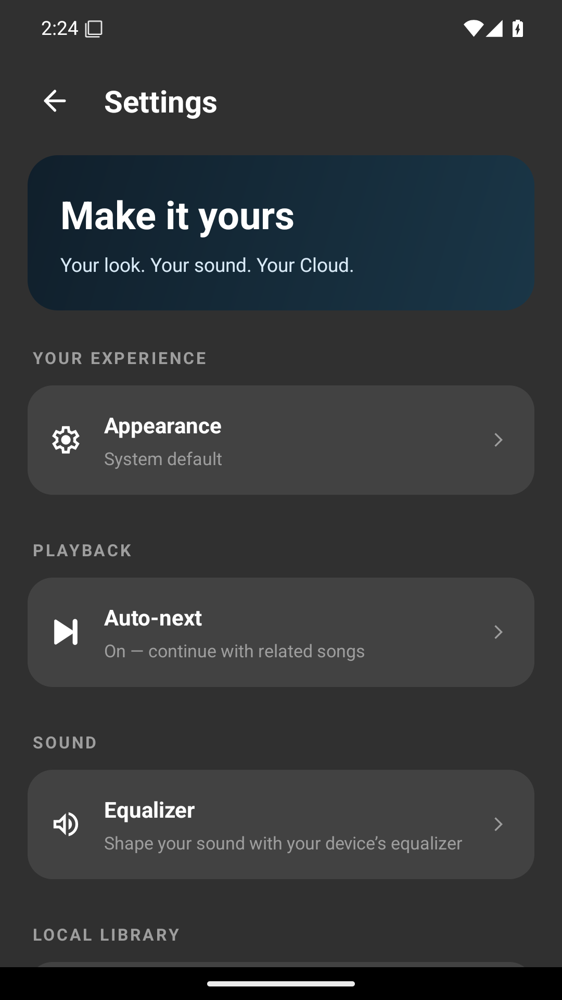

  

  
  
  
  

Listen to YouTube Music without signing in. Discover songs, build playlists, and keep listening with Cloud.

<a href="https://github.com/J1yann/Cloud/releases/latest"><strong>Download the APK</strong></a> · <a href="https://github.com/J1yann/Cloud/issues">Report an issue</a>

## A look inside Cloud

  
  
  
  

## Your music, within reach

| Discover | Listen | Make it yours |
| --- | --- | --- |
| Discovery shelves, new releases, charts, moods, and genres | Background playback, queues, shuffle, and repeat | Likes, personal playlists, and listening history |
| Search songs, artists, albums, and playlists | Related songs keep playing when your queue ends | Local music, AMOLED mode, and a sleep timer |

Start listening without an account, sign-in, or separate server setup. Your library
stays on your device. Cloud fetches catalog data and resolves audio streams on the
device. Availability depends on YouTube and your network.

## Install

Get the signed APK from [GitHub Releases](https://github.com/J1yann/Cloud/releases/latest)
and install it on **Android 6.0 or newer**. Each release includes a SHA-256 checksum.
Updates use the same signing key, so you can install them over an existing copy.
The app package is `cloud.music`.

## How Cloud works

Cloud browses YouTube Music’s catalog directly for songs, albums, artists,
playlists, and discovery shelves. NewPipe Extractor resolves the selected video’s
audio on the device, and Media3 handles playback, queues, and notifications.
Track IDs stay consistent from search through playback; Cloud does not choose a
replacement recording by title.

Word-by-word lyrics highlight in time with the music when word timestamps are
available. Line-synchronized and plain-text lyrics provide a fallback. Tap a timed
line to seek, or scroll freely through the lyrics.
Cloud uses undocumented service interfaces, so upstream changes can affect browsing
or playback. This app does not provide access to recordings unavailable to your connection.

## Credits

Cloud builds on [PonyMusic by wangchenyan](https://github.com/wangchenyan/ponymusic).
Discovery and player presentation draw inspiration from
[SimpMusic](https://github.com/maxrave-dev/SimpMusic).
[NewPipe Extractor](https://github.com/TeamNewPipe/NewPipeExtractor) provides audio
extraction, [Media3](https://github.com/androidx/media) handles playback, and
[BetterLyrics](https://github.com/better-lyrics/better-lyrics) and
[LRCLIB](https://lrclib.net) provide lyrics.

Cloud is an independent app and is not affiliated with YouTube or Google.
See [third-party credits](THIRD_PARTY_NOTICES.md) and [LICENSE](LICENSE).
